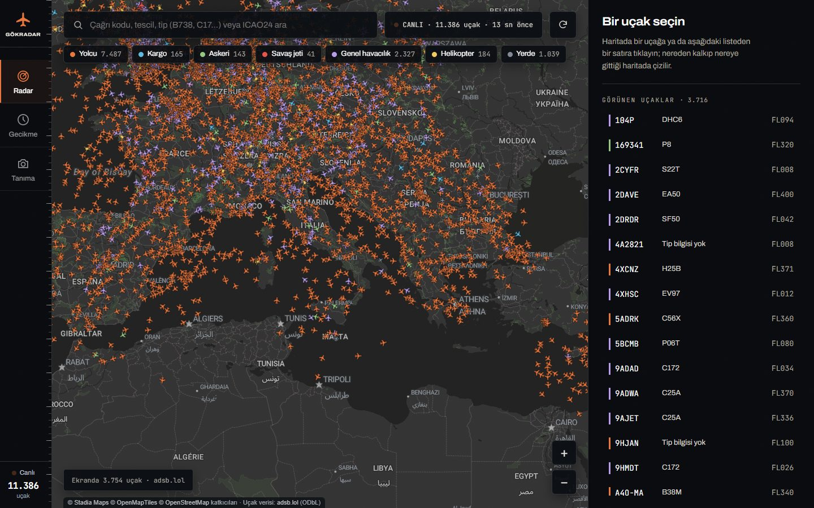
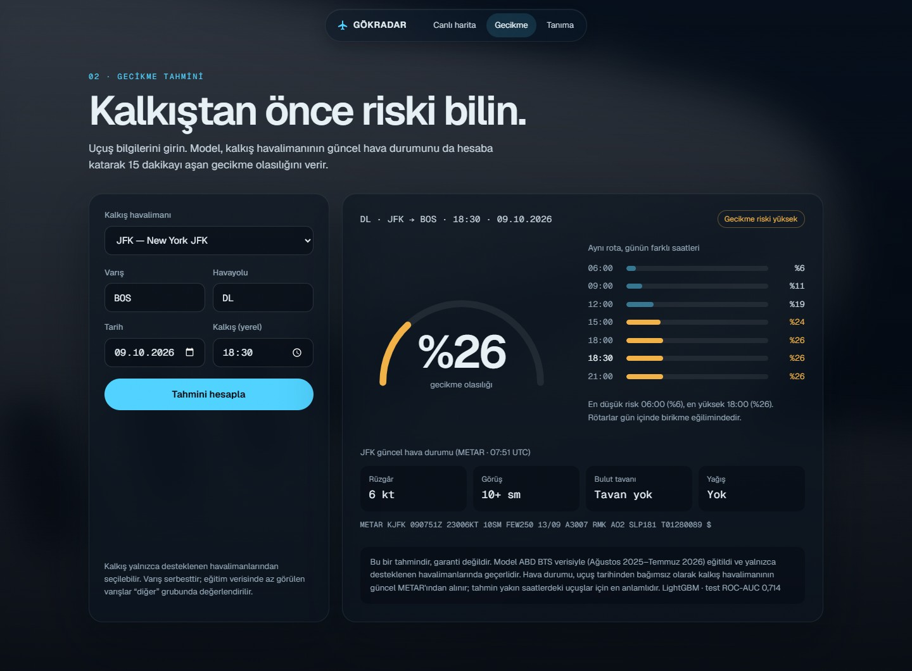
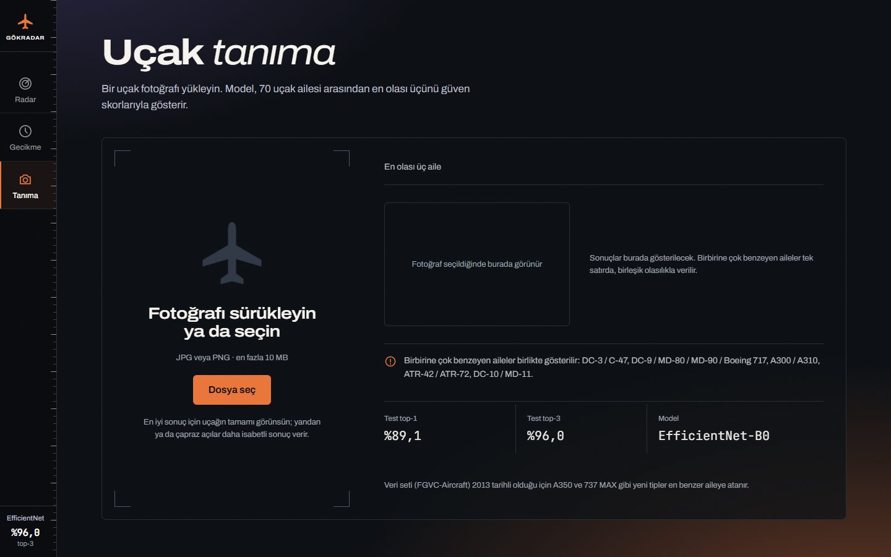

<div align="center">

# ✈️ GÖKRADAR

**Gökyüzündeki uçakları canlı izleyin, kalkışların gecikme riskini öngörün, bir fotoğraftan uçağın tipini tanıyın.**


-lightgrey)


</div>

---

## Neler yapar?

| | Modül | Ne sunar |
|---|---|---|
| 🛰️ | **Canlı harita** | Dünyadaki uçakları gerçek zamanlı gösterir (yolcu, kargo, askeri, savaş jeti, helikopter, genel havacılık). Uçak seçilince tescil, tip, operatör, rota, fotoğraf ve irtifa geçmişi görünür. |
| ⏱️ | **Gecikme tahmini** | Kalkış, varış, havayolu, tarih ve saat girilir; kalkış ve varış havalimanlarının **güncel METAR** hava durumu da hesaba katılarak uçuşun **15 dakikadan fazla gecikme olasılığı** döner. Aynı rota için günün farklı saatleri karşılaştırılır; bugünkü uçuşlarda **FAA NAS Status** uyarıları (yer bekletme, kalkış gecikmesi, kapanış) ayrıca gösterilir. |
| 📷 | **Uçak tanıma** | Yüklenen fotoğraftan **87 uçak ailesi** arasında en olası üç tahmin ve güven skorları (787, A350, A220, 737 MAX, F-35 gibi güncel tipler dahil). Birbirine çok benzeyen aileler (DC-3 / C-47 gibi) tek satırda birleştirilir. |

## Ekran görüntüleri

<table>
  <tr>
    <td width="50%"><br><sub><b>Ana sayfa</b>: kaydırdıkça kamera uçağın etrafında dolaşır</sub></td>
    <td width="50%"><br><sub><b>Canlı harita</b>: adsb.lol verisiyle dünya geneli, seçili uçağın rotası</sub></td>
  </tr>
  <tr>
    <td width="50%"><br><sub><b>Gecikme tahmini</b>: olasılık, günün saatleri, güncel METAR</sub></td>
    <td width="50%"><br><sub><b>Uçak tanıma</b>: fotoğraf yükle, en olası üç aileyi gör</sub></td>
  </tr>
</table>

<sub>Harita görüntüsünde Planespotters.net fotoğrafı telif nedeniyle bulanıklaştırıldı. Tanıma örneğindeki
fotoğraf: “Etihad Airways, A6-BLF, Boeing 787-9 Dreamliner”, Anna Zvereva, CC BY-SA 2.0 (Wikimedia Commons).</sub>

## Nasıl çalışır?

```
 Tarayıcı ──────────────► Flask API (waitress) ───────────────────────────────────────┐
  harita / form / yükleme    │  hız sınırı · CSP · önbellek · gzip                      │
                             ├─► DelayPredictor   LightGBM + kalkış/varış METAR'ı       │
                             ├─► NasStatusCache   FAA NAS Status (uyarı katmanı)        │
                             ├─► AircraftClassifier   ConvNeXt-Tiny (CUDA / CPU)        │
                             ├─► AdsbFeed         adsb.lol (dünya) + adsb.fi (askeri)   │
                             ├─► OpenSkyCache     bölge önbelleği + günlük kredi sayacı │
                             ├─► MetarCache · RouteLookup (adsbdb.com)                  │
                             └─► Repository ──► Neon PostgreSQL (uçak DB, NAS kayıtları)┘
```

- **Tek paylaşımlı anlık görüntü:** tüm kullanıcılar sunucudaki aynı canlı veri görüntüsünü alır; dış servise
  en fazla her 10 saniyede bir istek gider. Yanıt bir kez gzip'lenir, `ETag` ile değişmediyse `304` döner.
- **Modeller açılışta bir kez yüklenir**, her istekte değil. Gecikme tahmininde günün birden çok saati tek
  model çağrısıyla hesaplanır.
- **Gecikme modelinde veri sızıntısı yok:** yalnızca kalkıştan önce bilinen özellikler kullanılır
  (zaman, ay, tatile uzaklık, havayolu, rota, mesafe, kalkış ve varış METAR'ı, havalimanı yoğunluğu).
- **FAA NAS Status** olasılığa katılmaz; bugünkü uçuşlarda ayrı bir uyarı olarak gösterilir. Durum değiştikçe
  `nas_status_snapshots` tablosuna yazılır; yeterli geçmiş birikince modele özellik olarak eklenebilir.
- **Ana sayfa WebGL değildir:** Blender Cycles ile önceden render alınmış 439 karelik bir dizi, kaydırma
  oranına göre canvas'a çizilir (Apple ürün sayfalarındaki yöntem). Masaüstü 14 MB, mobil 6 MB WebP.

## Model sonuçları

**Gecikme modeli:** LightGBM, ABD'nin en yoğun 10 havalimanı (ATL, DFW, DEN, ORD, LAX, JFK, LAS, CLT, MCO, SEA)
çıkışlı uçuşlar, BTS verisinin Ağustos 2025–Temmuz 2026 dönemi (12 ay). Eğitim 2,10 milyon uçuş, son eğitim
günlerine 90 günlük zaman sönümüyle daha fazla ağırlık verilir. Test: son 14 gün (Temmuz 2026, 90 383 uçuş,
gecikme oranı %32,4).

| Model | ROC-AUC | PR-AUC | F1 | Recall | Brier |
|---|---|---|---|---|---|
| Lojistik regresyon (eşik ayarlı) | 0,695 | 0,510 | 0,545 | 0,727 | 0,199 |
| **LightGBM (eşik ayarlı)** ★ | **0,714** | **0,535** | **0,559** | **0,704** | **0,195** |

Ocak, Mart ve Temmuz 2026 üzerinde geriye dönük test (ortalama ROC-AUC):

| Eğitim ağırlığı | ROC-AUC |
|---|---|
| Tüm geçmiş, eşit ağırlık | 0,6941 |
| Yalnızca son 2 ay | 0,6934 |
| 30 günlük sönüm | 0,6936 |
| **90 günlük sönüm** ★ | **0,6943** |

> Gecikme çoğu zaman havalimanı yoğunluğu ve hava durumu gibi kontrol dışı etkenlere bağlıdır; bu yüzden
> sonuç bir **risk göstergesidir, garanti değil**.

**Uçak sınıflandırıcı:** ConvNeXt-Tiny (ImageNet ön eğitimli, ince ayar, 320 px), FGVC-Aircraft ve Wikimedia
Commons (CC lisanslı) fotoğrafları, 87 aile. Commons verisi fotoğrafçıya göre bölündü; aynı kişinin
neredeyse aynı kareleri farklı bölümlere düşmez. Test: 4 667 görüntü.

| Metrik | Test |
|---|---|
| Top-1 doğruluk | **%94,0** |
| Top-3 doğruluk | **%97,0** |
| Macro doğruluk | %94,2 |
| Top-1, yalnızca FGVC (3 333) | %95,2 |
| Top-1, yalnızca Commons (1 334) | %91,2 |

En çok karıştırılanlar DC-3 ↔ C-47 (arayüzde birleştirilir), Gripen ↔ Rafale ↔ MiG-29 ve 787 ↔ A350. Veri
setinde olmayan bir tip en benzer aileye atanır.

## Teknolojiler

| Katman | Kullanılanlar |
|---|---|
| Arka uç | Python 3.14, Flask, waitress, Flask-Compress, SQLAlchemy |
| Veritabanı | PostgreSQL (Neon, pooler bağlantısı) |
| Makine öğrenmesi | LightGBM, scikit-learn, pandas, PyTorch, torchvision, Pillow |
| Ön uç | Düz JavaScript ve CSS, Leaflet (harita), Geist yazı tipi |
| Görsel | Blender 4.5 Cycles (OptiX), Poly Haven HDRI |
| Veri | adsb.lol, adsb.fi, OpenSky Network, adsbdb.com, BTS, aviationweather.gov, Iowa Environmental Mesonet, FAA NAS Status, Wikimedia Commons |

## Kurulum

```powershell
py -3.14 -m venv .venv
.\.venv\Scripts\Activate.ps1
pip install -r requirements.txt
copy .env.example .env                          # değerleri doldurun
copy credentials.example.json credentials.json  # OpenSky kullanacaksanız (isteğe bağlı)
```

NVIDIA GPU için `requirements.txt` içindeki `--extra-index-url` satırının yorumunu kaldırın.

`.env` değişkenleri:

| Değişken | Açıklama |
|---|---|
| `DATABASE_URL` | Neon doğrudan bağlantı (tablo oluşturma, toplu yükleme) |
| `DATABASE_URL_POOLED` | Neon pooler bağlantısı (Flask API) |
| `OPENSKY_CREDENTIALS_PATH` | OpenSky OAuth2 dosyası; boşsa OpenSky kapanır, harita adsb.lol ile çalışır |
| `STADIA_API_KEY` | Harita karoları; localhost'ta boş bırakılabilir, gerçek alan adında gerekir |
| `TRUSTED_PROXY_HOPS` | Ters vekil arkasındaysa vekil sayısı (doğrudan erişimde `0`) |

> **Bu depoda olmayanlar:** `.env`, `credentials.json` (gizli bilgiler), `data/` (BTS/FGVC verileri) ve
> `models/` (eğitilmiş modeller). Uygulamanın açılması için modellerin aşağıdaki adımlarla eğitilmiş olması
> ve `.env`'de bir Neon adresi bulunması gerekir. Model dosyalarını (`.joblib` pickle biçimindedir) yalnızca
> kendi eğittiğinizden ya da güvendiğiniz kaynaktan yükleyin.

## Çalıştırma

```powershell
python -m src.api.app --port 5000      # waitress; modeller açılışta bir kez yüklenir
python -m src.api.app --dev            # Flask geliştirme sunucusu
```

Tarayıcıda <http://127.0.0.1:5000/> — `/` ana sayfa · `/harita` canlı harita · `/gecikme` gecikme tahmini ·
`/tanima` uçak tanıma.

## Verileri hazırlama ve model eğitimi

<details>
<summary><b>Adım adım komutlar</b> (veri → veritabanı → modeller)</summary>

**1. Veri toplama**
```powershell
python -m src.ingest.load_bts --download 2025-08 2026-07  # BTS'den 12 ayı indir → data/processed/bts_flights.parquet
python -m src.ingest.load_weather         # kalkış havalimanlarının IEM METAR'ı (load_bts'den sonra)
python -m src.ingest.load_weather --dest  # BTS'deki tüm varış havalimanlarının METAR'ı
python -m src.ingest.load_aircraft_db     # OpenSky aircraft DB → data/processed/aircraft.parquet
python -m src.ingest.load_fgvc            # FGVC-Aircraft → data/raw/fgvc/ + sınıf dağılımı raporu
python -m src.ingest.load_commons         # Wikimedia Commons'tan güncel tipler (collect → download → filter → split)
```
`--download` verilmezse `data/raw/bts/` içindeki ZIP/CSV dosyaları okunur. Commons toplama yarıda kalırsa aynı
komut kaldığı yerden sürer (tamamı yaklaşık 1,5 saat; API hız sınırına uyar).

**2. Veritabanı**
```powershell
python -m src.db.init_db               # tabloları ve indeksleri oluştur (nas_status_snapshots dahil; varsa dokunmaz)
python -m src.ingest.load_to_db aircraft  # Parquet → Neon (COPY); yalnızca uygulamanın kullandığı uçak tablosu
```
Eğitim verisi Neon'a yüklenmez; modeller yerel Parquet dosyalarından eğitilir (ücretsiz Neon kotası küçük).

**3. Gecikme modeli**
```powershell
python -m src.ml.delay.train           # LogReg + LightGBM, yerel Parquet'ten; çıktılar models/delay/ altında
python -m src.ml.delay.calibration     # kalibrasyon grafiği (yeniden eğitmeden)
```

**4. Fotoğraf sınıflandırma**
```powershell
python -m src.ml.vision.train select --arch convnext_tiny  # train'de eğit, val'de epoch seç
python -m src.ml.vision.train final    # seçilen ayarlarla train+val'de yeniden eğit
python -m src.ml.vision.evaluate       # test seti: yalnızca en sonda, bir kez
```
Eğitim her epoch sonunda `models/vision/checkpoints/` altına checkpoint yazar; yarıda kalırsa aynı komuta
`--resume` eklenerek sürdürülür. RTX 3060 Laptop ile select + final + evaluate yaklaşık 2 saat sürer.

**5. Ana sayfa sahnesi (isteğe bağlı)**
```powershell
# tools/blender/ içine b787.glb (depoda) ve sky.hdr (Poly Haven "qwantani_dusk_2_puresky" 4K, CC0) gerekir
blender -b --python tools/blender/scene.py -- --still hero,cockpit,window,top --pct 50   # deneme kareleri
blender -b --python tools/blender/scene.py -- --anim 1 --pct 100 --samples 256          # 220 kare
blender -b --python tools/blender/scene.py -- --inbetween 180 --pct 100 --samples 256   # iki kat sık dizi
python tools/encode_frames.py tools/blender/frames_ib   # PNG → src/web/static/seq/{d,m}/NNN.webp
```
Render yarıda kalırsa aynı komut var olan kareleri atlayarak sürer. RTX 3060 ile 1440p, 256 örnek: kare başına
7–30 sn.

</details>

## REST API

| Yöntem | Endpoint | Açıklama |
|---|---|---|
| GET | `/api/health` | Veritabanı durumu, model sürümleri, günlük OpenSky kredi sayacı |
| GET | `/api/airports` | Desteklenen kalkış havalimanları |
| GET | `/api/flights/world` | Dünya genelindeki tüm uçaklar (sıkıştırılmış, `ETag` destekli) |
| GET | `/api/flights/live?lamin=&lomin=&lamax=&lomax=` | Bölgedeki canlı uçaklar + tip/tescil (OpenSky, önbellekli) |
| GET | `/api/flights/<icao24>/detail` | Seçili uçağın ayrıntısı |
| GET | `/api/flights/route/<çağrı kodu>` | Kalkış/varış rotası ve ilerleme |
| GET | `/api/aircraft/<icao24>` | Uçak veritabanı kaydı |
| POST | `/api/predict-delay` | JSON: `origin, dest, airline, date (YYYY-MM-DD), dep_time (HH:MM, yerel)`; isteğe bağlı `compare_times` |
| POST | `/api/classify-aircraft` | `multipart/form-data`, alan `image` (JPG/PNG, ≤ 10 MB) → en olası 3 aile |

Örnek:

```powershell
curl -X POST http://127.0.0.1:5000/api/predict-delay -H "Content-Type: application/json" `
     -d '{"origin":"ATL","dest":"BOS","airline":"DL","date":"2026-10-02","dep_time":"19:00"}'
```

Hatalar her zaman `{"error": {"code": "...", "message": "..."}}` biçimindedir.

## Güvenlik ve performans

- **Güvenlik başlıkları:** her HTML yanıtında nonce'lı `Content-Security-Policy`, `X-Frame-Options`,
  `nosniff`, `Referrer-Policy`, `Permissions-Policy`; `/api/` yanıtları `no-store`.
- **Hız sınırı:** veritabanına/diske yazan ve dış servislere giden endpoint'ler IP başına sınırlıdır
  (`config.RATE_LIMITS_PER_MIN`; aşılınca `429` + `Retry-After`).
- **Girdi doğrulama:** havalimanı/havayolu/tarih/saat/koordinat doğrulanır; yüklenen dosyanın uzantısı ve gerçek
  içeriği (JPG/PNG), boyutu ve piksel sayısı kontrol edilir (sıkıştırma bombası koruması).
- **Güvenli model yükleme:** görüntü modeli `torch.load(weights_only=True)` ile açılır.
- **Gizli bilgiler** yalnızca `.env` ve `credentials.json` içindedir ve git'e girmez.
- **Önbellek ve sıkıştırma:** gzip/brotli; CSS/JS ve ana sayfa kareleri `?v=` ile sürümlenip bir yıl,
  diğer görseller bir gün önbelleğe alınır.
- **Dış servisler:** Google Fonts, unpkg (Leaflet, SRI ile), Stadia Maps ve Planespotters.net ziyaretçinin
  IP adresini ilgili servislerle paylaşır.
- Yüklenen fotoğraflar `data/uploads/` altında saklanır; kişisel veri içerebileceğinden düzenli temizleyin.

### Siteyi yayına alırken

İnternete açacaksanız önüne HTTPS sonlandıran bir ters vekil (nginx, Caddy, Cloudflare…) koyun, uygulamayı
yalnızca yerel porta bağlı bırakın ve `.env` içinde `TRUSTED_PROXY_HOPS=1` yapın. Harita karo anahtarını
(`STADIA_API_KEY`) Stadia panelinden alan adına kısıtlayın.

## Proje yapısı

```
config.py                 # tüm ayarlar (havalimanları, eşikler, önbellek süreleri, hız sınırları)
src/
├── api/                  # Flask uygulaması: app, routes, services, validation, ratelimit
├── web/                  # sayfalar, şablonlar, CSS/JS, ana sayfa kare dizisi (static/seq/)
├── services/             # adsb_feed, opensky_client/cache, metar_client, route_lookup, nas_status
├── ml/
│   ├── delay/            # gecikme modeli: train, evaluate, calibration, predict
│   └── vision/           # uçak sınıflandırıcı: train, evaluate, predict
├── features/             # gecikme özellikleri ve hava durumu eşleme
├── ingest/               # BTS, METAR, uçak DB, FGVC, Wikimedia Commons, Neon'a toplu yükleme
└── db/                   # bağlantı, tablolar (SQLAlchemy), depo sınıfı
tools/blender/            # ana sayfa sahnesi (Blender Cycles): scene.py ve 787 modeli (b787.glb)
tools/encode_frames.py    # render karelerini masaüstü/mobil WebP dizisine çevirir
```

## Veri kaynakları, atıflar ve lisans

- Uçuş gecikmeleri: ABD BTS On-Time Performance; hava durumu: Iowa Environmental Mesonet ve aviationweather.gov (METAR).
- Canlı konumlar: [adsb.lol](https://adsb.lol) (ODbL), adsb.fi ve OpenSky Network; rotalar: adsbdb.com; fotoğraflar:
  Planespotters.net (kullanım koşulları gereği fotoğrafçıya ve sayfaya bağlanır).
- FAA NAS Status (nasstatus.faa.gov): ABD havalimanlarındaki anlık programlar ve kapanışlar.
- Fotoğraf modeli FGVC-Aircraft (yalnızca araştırma/ticari olmayan kullanım) ve Wikimedia Commons fotoğraflarıyla
  (CC BY / CC BY-SA; yazar ve lisans bilgisi `data/raw/commons/manifest.csv` içinde) eğitilir. Veriler bu depoda
  dağıtılmaz.
- Ana sayfadaki 3B model: [“Boeing 787-8”](https://sketchfab.com/3d-models/boeing-787-8-22a06131abdf4158a81f9ad2ddfde5b9),
  [rocket0314](https://sketchfab.com/rocket0314) (Sketchfab), [CC BY 4.0](https://creativecommons.org/licenses/by/4.0/); render kareleri bu modelden
  Blender Cycles ile üretildi. Gökyüzü ışığı: “Qwantani Dusk 2 (Pure Sky)”, Poly Haven, CC0.
- Harita karoları: Stadia Maps, OpenMapTiles, OpenStreetMap katkıcıları (Stadia'nın ücretsiz planı ticari olmayan
  kullanım içindir).

**Lisans:** özel lisans, tüm hakları saklıdır — bkz. [`LICENSE`](LICENSE). Üçüncü taraf bileşenler kendi
lisanslarına tabidir.
